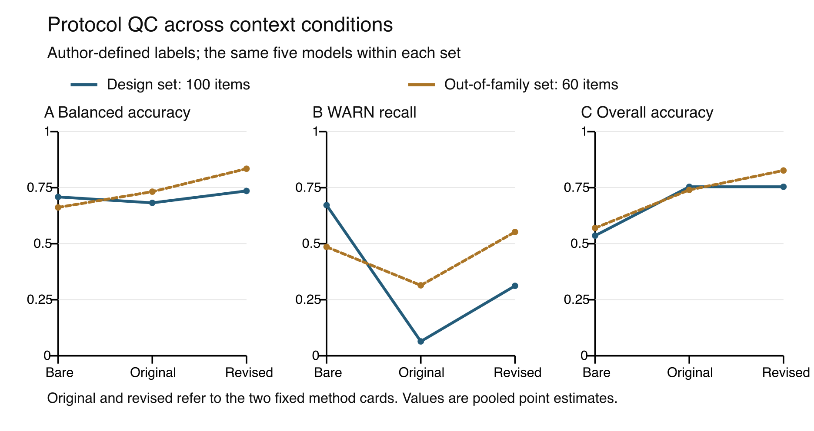

# RealBio

**Evaluating language-model decisions in bioinformatics**

RealBio examines decisions that support bioinformatics workflows: choosing a workflow, extracting requested parameters, selecting a statistical method, classifying a failure and interpreting protocol-specific QC signals. The current study compares saved model predictions with fixed references. **It does not execute workflows or test successful automatic repair.**

The central question is how supplied context changes the same model's answers, including errors that an aggregate score can hide. This is a condition comparison, not a product-versus-model ranking.
## Tasks and evidence

| Component | Items | Current evidence |
|---|---:|---|
| Workflow routing | 200 | Paired bare-versus-described-vocabulary comparisons across 14 model endpoints |
| Parameter extraction | 170 | Four paired endpoints; three are Qwen-family models; F1, forbidden fills and joint success reported separately |
| Method selection | 40 | Eight paired endpoints; candidate names versus names plus descriptions |
| Failure classification | 100 | Historical descriptive task; category prediction, not a demonstrated repair |
| Protocol QC: design set | 100 | Five-model card-revision study; a distinct serving-matched comparison is retained separately |
| Protocol QC: out-of-family set | 60 | Same five-model panel, with bare, original-card and revised-card conditions |

The rows have different endpoints and evidence histories. They are not pooled into one overall score. The historical 40-item workflow-generation task is retained as a diagnostic resource, outside the primary capability claims: its two-branch scorer saturates near 0.50 for many systems.

## Main paired comparisons

| Endpoint | Models | Bare | Guided | Difference [95% interval] |
|---|---:|---:|---:|---|
| Routing accuracy | 14 | 0.382 | 0.913 | +0.530 [0.484, 0.578] |
| Parameter F1 | 4 | 0.079 | 0.701 | +0.622 [0.580, 0.660] |
| Parameter joint success | 4 | 0.179 | 0.371 | +0.191 [0.122, 0.260] |
| Method-selection accuracy | 8 | 0.925 | 0.988 | +0.0625 [0.022, 0.116] |

Joint parameter success requires every required value to match and no listed forbidden key to be emitted. It is not exact-object correctness: other extra keys can escape that joint criterion. Mean exact-object success under the historical value-equivalence rule is 0.078 bare and 0.371 guided. Of the 170 items, 26 require no keys; historical empty-object coercion can earn vacuous success on that subset. These scoring effects are disclosed and stratified in the supplementary analysis.

Context increases parameter completeness but also increases forbidden fills. For method selection, six of eight per-model intervals include zero; the positive aggregate difference is not a universal improvement for every endpoint.

### Protocol-QC result

The original card raises overall accuracy while suppressing WARN recall. On the 60 out-of-family items, the revised card raises pooled balanced accuracy from 0.732 to 0.834: **+0.102 [0.050, 0.154]**. WARN recall changes from 0.314 to 0.552: +0.238 [0.100, 0.377]. The models and items are paired within this comparison; repeated predictions are not independent new cases.



Both QC sets use the authors' PASS/WARN/FAIL framework. Disjoint IDs and exact protocol strings reduce direct overlap, but do not establish independent label validity or eliminate semantic similarity. Card revision changes the WARN criterion, examples and a design-informed class-prior cue together. The observed difference cannot be attributed to one rule alone.

A sensitivity analysis reuses 180 existing annotations from three LLMs on the **same 60 items**. Majority labels agree with 54/60 author labels (90%; Cohen's κ=0.837). The revised-minus-original balanced-accuracy difference remains positive: +0.114 [0.052, 0.177]. This is alternative model-generated labeling, not independent expert validation; three annotation endpoints also occur in the evaluation panel. The two non-annotating endpoints are reported separately, descriptively.
## What each condition supplies

- **Routing:** a fixed vocabulary of 63 workflow labels derived from the benchmark's reference labels, with database descriptions truncated to 120 characters. It is not the full production catalog or independently retrieved candidates. Bare outputs use the same label-aware parser.
- **Parameters:** each item's candidate-key list is the union of its required-key annotations and forbidden-key distractors. Values and the required/forbidden partition remain hidden. This is annotation-informed extraction, not a full independently retrieved schema.
- **Methods:** descriptions and input types are looked up for candidates already supplied in the item. The historical `_kb` identifier does not denote query-based top-k retrieval.
- **QC:** a task-level method card, with original and revised versions archived separately. No downstream scientific run or automated repair is scored.

The parameter scorer's alias and containment rules are **score-time equivalence**, not demonstrated generation-time production normalization. The historical scorer remains unchanged, including its permissive substring rule. Additional exact-value and exact-object analyses expose sensitivity to those rules.

Intervals describe item-resampling uncertainty conditional on the retained model snapshots. Models are not independent population replicates. Historical provider revisions, raw prompts and database snapshots are incomplete; pairing older routing/parameter/method runs by endpoint label and item does not establish fully matched serving. Annotation provenance, possible training contamination and scientific label validity require further independent audit. No superiority over other benchmark suites or universal BioMate product score is claimed.

## Dataset construction and intended use

Items are author-constructed requests or protocol vignettes with fixed labels; they are not observed scientific-run outcomes. Routing labels reference workflow catalogs; parameter references and distractors are item annotations; methods use curated candidate choices; failure items classify error scenarios. QC accessions are retained historical metadata and have not been independently verified as observed QC outcomes for those accessions. No assertion of immunity from model-training contamination is made.

Use the configurations under `data/` separately. Their sizes are 200, 170, 40, 100, 100 and 60. The design QC set has 70 PASS / 25 WARN / 5 FAIL labels; the out-of-family set has 30 / 21 / 9. Alternative model-majority labels are 32 / 15 / 13 on those same 60 items. Neither annotation set is an independent clinical truth set. Future work needs condition-blinded expert adjudication, a method-free card control, repeated generations and genuinely independent workflow execution.

The public dataset is development-exposed. Do not treat it as a hidden holdout after using it for tuning. Historical artifacts and scorer versions remain identifiable in the integrity manifest. Existing CC BY 4.0 project notices and third-party terms apply separately.
## Reproduce the reported analyses

The `reproduction/` directory is a shared, allowlisted snapshot for **both RealBio and RealDrug**. Historical directory names are preserved. It contains 110 primary prediction files and 22 supporting historical files, fixed references, original scoring rules, archived method-card/prompt code, generators and supplementary analyses. The counts describe prediction files, not independent tasks or cases.

```bash
cd reproduction
python3 -I reproduce.py
python3 -I bootstrap_primary.py > primary-bootstrap.json
python3 -I supplementary_analysis.py --output supplementary-recomputed.json
python3 -I verify_generated_references.py --output references-recomputed.json
```

These commands make **no model calls** and require only Python's standard library. The first verifies SHA-256 hashes and exact item-ID coverage before scoring. The historical credential-acquisition helper is replaced with an explicit failing stub in the archival harness; scientific prompts and cards are retained. The transformation is documented in `provenance-transformations.json`. Historical provider/database snapshots remain incomplete: offline reproduction of saved scores is not exact replay of original API calls.

The top-level `leaderboard.md` / `.csv` now show condition comparisons, not a product ranking. Previous public leaderboards and figures are preserved under `archive/pre-20261122/` for provenance and are **superseded**. Older papers in `paper/` are likewise historical; see `paper/README.md`. The revised preprint (v8, 22 November 2026) is [`paper/RealBio-preprint-v8.pdf`](paper/RealBio-preprint-v8.pdf); this release is tagged `v2026.11.22`.
